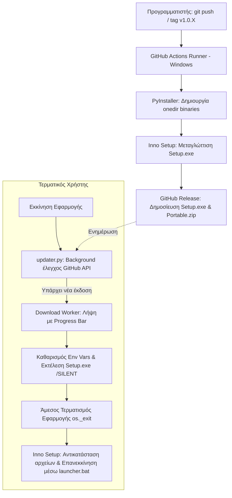

# Auto-Update & CI/CD Packaging Blueprint (PyInstaller + Inno Setup + GitHub Actions)

Ακολουθεί η **πλήρης, ολοκληρωμένη παρουσίαση** της αρχιτεκτονικής αυτόματων ενημερώσεων (Auto-Update) και του pipeline συσκευασίας μέσω GitHub Actions, σχεδιασμένη ώστε να μπορείτε να την αντιγράψετε και να την εφαρμόσετε σε **οποιαδήποτε άλλη desktop εφαρμογή Python (PyQt / PySide / Tkinter / wxPython)**.

---

# 1. Συνολική Αρχιτεκτονική & Ροή Λειτουργίας

Το σύστημα βασίζεται σε 4 πυλώνες:



### Γιατί επιλέχθηκε αυτή η μέθοδος;

1. **Μηδενικά προαπαιτούμενα για τον χρήστη**: Ο χρήστης δεν χρειάζεται Python, pip ή δικαιώματα διαχειριστή (UAC).
2. **Απόλυτη ακεραιότητα δεδομένων**: Οι τοπικές βάσεις δεδομένων (`.db`), τα αρχεία ρυθμίσεων (`.ini`, `.json`) και τα έγγραφα **δεν διαγράφονται ούτε αντικαθίστανται ποτέ** κατά την αναβάθμιση.
3. **Αόρατη (Silent) αναβάθμιση**: Γίνεται στο παρασκήνιο με ένα κλικ, κλείνει ομαλά την παλιά έκδοση, αντικαθιστά τα αρχεία και επανεκκινεί αυτόματα τη νέα έκδοση.

---

# 2. Τα 5 Βασικά Αρχεία του Συστήματος

Για να εφαρμόσετε τη μέθοδο στη νέα σας εφαρμογή, χρειάζεστε ακριβώς αυτά τα 5 αρχεία:

---

### Αρχείο 1: `version.py` (Διαχείριση Έκδοσης & Repo)

Ορίζει την τρέχουσα έκδοση και το αποθετήριο προορισμού.

```python
"""
version.py - Κεντρικός ορισμός έκδοσης εφαρμογής
"""
__version__ = "1.0.0"
GITHUB_REPO = "to-onoma-sas/to-repo-sas"
```

---

### Αρχείο 2: `updater.py` (Έλεγχος, Λήψη & Εκτέλεση)

Διαχειρίζεται τον ασύγχρονο έλεγχο στο GitHub API, το κατέβασμα σε ξεχωριστό Thread με μπάρα προόδου, και την ασφαλή αποσύνδεση του παλιού process.

**Κρίσιμα σημεία κώδικα:**

1. **Background Thread**: Δεν παγώνει το GUI κατά τη λήψη.
2. **Καθαρισμός Μεταβλητών Περιβάλλοντος (PyInstaller Sanitize)**: Όταν εκτελείται από PyInstaller, το λειτουργικό σύστημα κληρονομεί τις μεταβλητές `_MEIPASS` και `_PYI_*`. Αν δεν καθαριστούν, η νέα εφαρμογή θα προσπαθήσει να διαβάσει βιβλιοθήκες DLL από τον διαγραμμένο προσωρινό φάκελο της παλιάς έκδοσης και θα κρασάρει με `Failed to load Python DLL`!
3. **Εκτέλεση & Άμεσος Τερματισμός**: Το μήνυμα ενημέρωσης εμφανίζεται **πριν** κληθεί ο installer. Με το που εκτελείται ο installer, η εφαρμογή τερματίζει αμέσως με `os._exit(0)` ώστε να μην κλειδώνει τα αρχεία `.exe`/`.dll`.

```python
import os
import sys
import subprocess
import tempfile
import urllib.request
import json
from PyQt6.QtCore import QThread, pyqtSignal
from PyQt6.QtWidgets import QMessageBox, QProgressDialog
from version import __version__, GITHUB_REPO

class DownloadWorker(QThread):
    progress = pyqtSignal(int, str)
    finished = pyqtSignal(str)
    error = pyqtSignal(str)

    def __init__(self, download_url, destination_path):
        super().__init__()
        self.download_url = download_url
        self.destination_path = destination_path
        self._is_cancelled = False

    def cancel(self):
        self._is_cancelled = True

    def run(self):
        try:
            req = urllib.request.Request(self.download_url, headers={'User-Agent': 'Mozilla/5.0'})
            with urllib.request.urlopen(req, timeout=30) as response, open(self.destination_path, 'wb') as out_file:
                total_size = int(response.info().get('Content-Length', 0))
                bytes_downloaded = 0
                chunk_size = 64 * 1024

                while True:
                    if self._is_cancelled:
                        out_file.close()
                        if os.path.exists(self.destination_path):
                            os.remove(self.destination_path)
                        return
                    chunk = response.read(chunk_size)
                    if not chunk:
                        break
                    out_file.write(chunk)
                    bytes_downloaded += len(chunk)
                    if total_size > 0:
                        percent = int((bytes_downloaded / total_size) * 100)
                        self.progress.emit(percent, f"{bytes_downloaded / (1024*1024):.1f} MB / {total_size / (1024*1024):.1f} MB")
            self.finished.emit(self.destination_path)
        except Exception as e:
            self.error.emit(str(e))

def check_for_updates(parent=None, silent=False):
    """Ελέγχει το GitHub API για νεότερο release."""
    api_url = f"https://api.github.com/repos/{GITHUB_REPO}/releases/latest"
    try:
        req = urllib.request.Request(api_url, headers={'User-Agent': 'Mozilla/5.0'})
        with urllib.request.urlopen(req, timeout=10) as resp:
            data = json.loads(resp.read().decode('utf-8'))
            latest_tag = data.get("tag_name", "").lstrip("v")
            
            # Σύγκριση εκδόσεων (π.χ. "1.0.1" > "1.0.0")
            if is_newer_version(latest_tag, __version__):
                setup_asset = next((a for a in data.get("assets", []) if a["name"].endswith("Setup_Latest.exe") or a["name"].endswith("Setup.exe")), None)
                if setup_asset:
                    prompt_and_download_update(parent, latest_tag, setup_asset["browser_download_url"])
            elif not silent:
                QMessageBox.information(parent, "Ενημέρωση", "Έχετε ήδη την πιο πρόσφατη έκδοση!")
    except Exception as e:
        if not silent:
            QMessageBox.warning(parent, "Σφάλμα", f"Αποτυχία ελέγχου ενημερώσεων: {e}")

def prompt_and_download_update(parent, new_version, download_url):
    reply = QMessageBox.question(
        parent, "Διαθέσιμη Ενημέρωση",
        f"Βρέθηκε νέα έκδοση v{new_version}!\nΘέλετε να πραγματοποιηθεί αυτόματη λήψη και εγκατάσταση;",
        QMessageBox.StandardButton.Yes | QMessageBox.StandardButton.No
    )
    if reply != QMessageBox.StandardButton.Yes:
        return

    temp_dir = tempfile.gettempdir()
    installer_path = os.path.join(temp_dir, f"update_setup_{new_version}.exe")

    progress_dialog = QProgressDialog("Γίνεται λήψη της ενημέρωσης...", "Ακύρωση", 0, 100, parent)
    progress_dialog.setWindowModality(Qt.WindowModality.ApplicationModal)

    worker = DownloadWorker(download_url, installer_path)
    worker.progress.connect(lambda p, txt: (progress_dialog.setValue(p), progress_dialog.setLabelText(f"Λήψη: {txt}")))
    
    def on_finished(path):
        progress_dialog.close()
        # Ενημέρωση του χρήστη ΠΡΙΝ εκκινήσει ο installer
        QMessageBox.information(parent, "Εγκατάσταση", "Η λήψη ολοκληρώθηκε! Η εφαρμογή θα τερματιστεί για να ολοκληρωθεί η εγκατάσταση.")
        launch_silent_installer(path)

    worker.finished.connect(on_finished)
    progress_dialog.canceled.connect(worker.cancel)
    worker.start()

def launch_silent_installer(installer_path):
    """Εκκινεί τον Inno Setup installer σε silent mode και καθαρίζει το περιβάλλον."""
    # Κρίσιμος καθαρισμός μεταβλητών PyInstaller
    clean_env = os.environ.copy()
    for var in list(clean_env.keys()):
        if var.startswith("_PYI") or var.startswith("_MEI") or var in ("PYTHONPATH", "PYTHONHOME"):
            del clean_env[var]
    clean_env["PYINSTALLER_RESET_ENVIRONMENT"] = "1"

    # Εκτέλεση Inno Setup με σημαίες /SILENT και αποφυγή κληρονομικότητας λαβών
    DETACHED_PROCESS = 0x00000008
    subprocess.Popen(
        [installer_path, "/SILENT", "/CLOSEAPPLICATIONS", "/RESTARTAPPLICATIONS=0"],
        env=clean_env,
        creationflags=DETACHED_PROCESS,
        close_fds=True
    )
    # Άμεσος τερματισμός για να μην κλειδώνει τα αρχεία .exe
    os._exit(0)
```

---

### Αρχείο 3: `launcher.bat` (Αποφυγή Κρασαρίσματος DLL)

Τοποθετείται στον ριζικό φάκελο της εφαρμογής και καλείται από τον installer για να επανεκκινήσει την εφαρμογή απομονωμένη από τυχόν παλιά περιβάλλοντα εκτέλεσης.

```bat
@echo off
setlocal
:: Πλήρης καθαρισμός μεταβλητών PyInstaller
set "_MEIPASS="
set "_MEIPASS2="
set "PYINSTALLER_RESET_ENVIRONMENT=1"
for /f "tokens=1 delims==" %%v in ('set _PYI_ 2^>nul') do set "%%v="

:: Εκκίνηση του κυρίως εκτελέσιμου
start "" "%~dp0YourApp.exe"
exit /b 0
```

---

### Αρχείο 4: `installer.iss` (Inno Setup Script)

Το script εγκατάστασης που συνθέτει τον installer. 

**Βασικές ρυθμίσεις ασφαλείας:**

1. `PrivilegesRequired=lowest`: Εγκατάσταση στο `LocalAppData\Programs`, ώστε να **μην ζητάει κωδικό διαχειριστή** ούτε κατά την πρώτη εγκατάσταση ούτε κατά το auto-update!
2. `CloseApplications=yes`: Κλείνει αυτόματα την εφαρμογή αν τυχόν τρέχει.
3. Διαχωρισμός στο `[Run]`: 
   - Στην κανονική εγκατάσταση εκτελείται με `skipifsilent`.
   - Στην αυτόματη (`/SILENT`) εκτελείται **χωρίς** `skipifsilent` μέσω του `launcher.bat` (έτσι επιτυγχάνεται η αυτόματη επανεκκίνηση μετά το update).
4. `[Files]`: Προσθέτουμε τη σημαία `onlyifdoesntexist` για αρχεία βάσης δεδομένων ή ρυθμίσεων ώστε να μην αντικαθίστανται ποτέ!

```iss
#define MyAppName "MyApp"
#define MyAppVersion "1.0.0"
#define MyAppPublisher "YourName"
#define MyAppExeName "YourApp.exe"

[Setup]
AppId={{YOUR-UNIQUE-GUID-HERE}}
AppName={#MyAppName}
AppVersion={#MyAppVersion}
AppPublisher={#MyAppPublisher}
DefaultDirName={localappdata}\Programs\{#MyAppName}
DefaultGroupName={#MyAppName}
PrivilegesRequired=lowest
OutputDir=Output
OutputBaseFilename=MyApp_Setup_v{#MyAppVersion}
Compression=lzma2/ultra64
SolidCompression=yes
CloseApplications=yes
RestartApplications=no
SetupIconFile=assets\app_icon.ico
UninstallDisplayIcon={app}\{#MyAppExeName}

[Files]
; Αντιγραφή όλων των παραγόμενων αρχείων του PyInstaller onedir
Source: "dist\YourApp\*"; DestDir: "{app}"; Flags: ignoreversion recursesubdirs createallsubdirs
; Αντιγραφή του launcher.bat
Source: "launcher.bat"; DestDir: "{app}"; Flags: ignoreversion
; Αντιγραφή του εικονιδίου για ασφαλές referencing
Source: "assets\app_icon.ico"; DestDir: "{app}\assets"; Flags: ignoreversion
; ΠΡΟΣΟΧΗ: Αν υπάρχει αρχείο βάσης δεδομένων ή ρυθμίσεων:
; Source: "database.db"; DestDir: "{app}"; Flags: onlyifdoesntexist uninsneveruninstall

[Icons]
Name: "{autoprograms}\{#MyAppName}"; Filename: "{app}\{#MyAppExeName}"; IconFilename: "{app}\assets\app_icon.ico"
Name: "{autodesktop}\{#MyAppName}"; Filename: "{app}\{#MyAppExeName}"; IconFilename: "{app}\assets\app_icon.ico"

[Run]
; 1. Κανονική εγκατάσταση (interactive): Ρωτάει τον χρήστη αν θέλει άμεση εκκίνηση
Filename: "{app}\{#MyAppExeName}"; Description: "Εκκίνηση {#MyAppName}"; Flags: nowait postinstall skipifsilent; Check: not WizardSilent
; 2. Silent Auto-Update: Επανεκκίνηση αυτόματα μέσω launcher.bat χωρίς εμφάνιση παραθύρου
Filename: "{app}\launcher.bat"; Flags: nowait runhidden; Check: WizardSilent
```

---

### Αρχείο 5: `.github/workflows/package.yml` (CI/CD Pipeline)

Το workflow που τρέχει αυτόματα στο GitHub κάθε φορά που δημιουργείτε ένα **Tag** (π.χ. `v1.0.1`) ή χειροκίνητα (`workflow_dispatch`).

**Τι κάνει:**

1. Στήνει καθαρό περιβάλλον Windows.
2. Εγκαθιστά την Python και τα dependencies (`requirements.txt`).
3. Εγκαθιστά το **Inno Setup** μέσω Chocolatey.
4. Τρέχει το PyInstaller σε μορφή `onedir`.
5. Φτιάχνει **Portable ZIP** και **Setup Installer (.exe)**.
6. Δημιουργεί αυτόματα **GitHub Release** και ανεβάζει τα αρχεία τόσο με έκδοση (`MyApp_Setup_v1.0.1.exe`) όσο και με σταθερό όνομα (`MyApp_Setup_Latest.exe`) για άμεσα download links.

```yaml
name: Package & Release

on:
  push:
    tags:
      - 'v*'
  workflow_dispatch:

permissions:
  contents: write

jobs:
  build-windows:
    runs-on: windows-latest
    steps:
      - name: Checkout Source Code
        uses: actions/checkout@v4

      - name: Set up Python
        uses: actions/setup-python@v5
        with:
          python-version: '3.11'
          cache: 'pip'

      - name: Install Inno Setup
        run: choco install innosetup -y --no-progress

      - name: Install Python Dependencies
        run: |
          python -m pip install --upgrade pip
          pip install -r requirements.txt pyinstaller

      - name: Build Executable with PyInstaller
        run: |
          pyinstaller --noconfirm --onedir --windowed `
            --icon "assets/app_icon.ico" `
            --name "YourApp" `
            --add-data "assets;assets" `
            main.py

      - name: Create Portable ZIP
        run: |
          Compress-Archive -Path "dist\YourApp\*" -DestinationPath "dist\YourApp_Portable.zip" -Force

      - name: Compile Inno Setup Installer
        run: |
          & "C:\Program Files (x86)\Inno Setup 6\ISCC.exe" installer.iss

      - name: Prepare Release Assets
        shell: pwsh
        run: |
          $ver = (Select-String -Path "version.py" -Pattern '__version__\s*=\s*["'']([^"'']+)["'']').Matches.Groups[1].Value
          Copy-Item "dist\YourApp_Portable.zip" "YourApp_Portable_v$ver.zip"
          Copy-Item "dist\YourApp_Portable.zip" "YourApp_Portable_Latest.zip"
          $setupFile = Get-ChildItem -Path "Output" -Filter "*.exe" | Select-Object -First 1
          Copy-Item $setupFile.FullName "YourApp_Setup_v$ver.exe"
          Copy-Item $setupFile.FullName "YourApp_Setup_Latest.exe"

      - name: Publish GitHub Release
        uses: softprops/action-gh-release@v2
        if: startsWith(github.ref, 'refs/tags/') || github.event_name == 'workflow_dispatch'
        with:
          name: "Release v${{ env.APP_VERSION }}"
          draft: false
          prerelease: false
          generate_release_notes: true
          files: |
            YourApp_Setup_*.exe
            YourApp_Portable_*.zip
```

---

# 3. Τα 5 Κρίσιμα Προβλήματα (Gotchas) & Πώς Λύθηκαν

| #     | Σύνηθες Σφάλμα                         | Γιατί συμβαίνει;                                                                                                                        | Η Λύση μας                                                                                                                                                |
| ----- | -------------------------------------- | --------------------------------------------------------------------------------------------------------------------------------------- | --------------------------------------------------------------------------------------------------------------------------------------------------------- |
| **1** | **Κλείδωμα Αρχείων (File Locking)**    | Το παλιό `.exe` τρέχει ακόμη όταν ο installer προσπαθεί να το αντικαταστήσει.                                                           | Εμφάνιση του μηνύματος `QMessageBox` **πριν** κληθεί ο installer, αποσύνδεση (`creationflags=DETACHED_PROCESS`) και άμεσος τερματισμός με `os._exit(0)`.  |
| **2** | **Crash: `Failed to load Python DLL`** | Το παιδικό process κληρονομεί τις μεταβλητές `_MEIPASS` / `_PYI_*` που δείχνουν σε διεγραμμένο temp folder.                             | Καθαρισμός του `os.environ` στο `updater.py` και εκκίνηση μέσω του `launcher.bat` με `PYINSTALLER_RESET_ENVIRONMENT=1`.                                   |
| **3** | **Δεν επανεκκινεί μετά το Update**     | Στο `installer.iss` υπάρχει η σημαία `skipifsilent`. Σε `/SILENT` update, η εγκατάσταση ολοκληρώνεται αλλά η εφαρμογή δεν ανοίγει ποτέ! | Δύο καταχωρήσεις στο `[Run]`: μία με `skipifsilent` για τον χρήστη και μία χωρίς `skipifsilent` με έλεγχο `Check: WizardSilent` για το auto-update.       |
| **4** | **Απώλεια Βάσης Δεδομένων Χρήστη**     | Επανεγκατάσταση πάνω στον ίδιο φάκελο σβήνει ή αντικαθιστά το `.db`.                                                                    | Εξαίρεση του `.db` από το PyInstaller build και χρήση `onlyifdoesntexist` + `uninsneveruninstall` στο Inno Setup.                                         |
| **5** | **Απαίτηση UAC / Admin δικαιωμάτων**   | Ο installer προσπαθεί να γράψει στο `C:\Program Files`.                                                                                 | Χρήση `PrivilegesRequired=lowest` και προορισμός στο `{localappdata}\Programs`. Οποιοσδήποτε χρήστης μπορεί να κάνει update χωρίς κωδικούς administrator! |

---

# 4. Βήματα Εφαρμογής στη Νέα σας Εφαρμογή (Checklist)

1. **Αντιγράψτε τα 4 βοηθητικά αρχεία**:
   - [`version.py`](file:///c:/Users/grego/Desktop/Protocols/version.py) (αλλάξτε όνομα repo και έκδοση).
   - [`updater.py`](file:///c:/Users/grego/Desktop/Protocols/updater.py) (έτοιμο, δεν χρειάζεται αλλαγές).
   - [`launcher.bat`](file:///c:/Users/grego/Desktop/Protocols/launcher.bat) (αλλάξτε το όνομα του `.exe`).
   - [`installer.iss`](file:///c:/Users/grego/Desktop/Protocols/installer.iss) (αλλάξτε `MyAppName`, `MyAppExeName` και παράγετε νέο GUID).
2. **Κλήση του updater στο `main.py` της νέας εφαρμογής**:

   ```python
   # Στο main window show:
   from PyQt6.QtCore import QTimer
   from updater import check_for_updates
   
   # Έλεγχος 3 δευτερόλεπτα μετά το άνοιγμα ώστε να μην καθυστερεί η εκκίνηση
   QTimer.singleShot(3000, lambda: check_for_updates(parent=main_window, silent=True))
   ```
3. **Προσθήκη του GitHub Actions Workflow**:
   - Δημιουργήστε το φάκελο `.github/workflows/package.yml`.
4. **Δημοσίευση Νέας Έκδοσης**:
   - Αλλάζετε το `__version__ = "1.0.1"` στο `version.py`.
   - Κάνετε git commit & tag:

     ```bash
     git add .
     git commit -m "Release v1.0.1"
     git tag v1.0.1
     git push origin main --tags
     ```
   - Το GitHub Actions αναλαμβάνει τα υπόλοιπα αυτόματα!

---

> 
